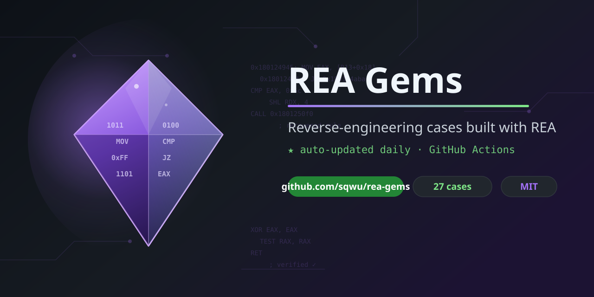

# REA Gems

<p align="center">
  
</p>

[](https://github.com/sqwu/rea-gems/actions/workflows/update.yml)
[](data/cases.json)
[](LICENSE)

**A curated, auto-updated gallery of excellent reverse-engineering cases built with [REA](https://github.com/morluto/rea).**

[REA](https://github.com/morluto/rea) ("reverse engineer anything") connects your
coding agent to tools for inspecting native binaries, JavaScript/Electron apps,
.NET assemblies and websites — and explains how features work, with evidence.
This repo tracks the best things people have **understood, rebuilt or
reconstructed** with it: official case studies, community projects, blog posts
and discussions, collected automatically from across the web.

<p align="center">
  
</p>

> **352 cases** collected · **135 added in the last 30 days** · last refresh: **2026-11-28 (UTC)**

<details>
<summary><strong>Disclaimer</strong></summary>

This repository is an unofficial community project and is not affiliated with
the REA team. All case links point to their original authors. Reverse
engineering may be restricted by local law, software licenses or terms of
service — always respect them. Content is indexed for research and educational
purposes.
</details>

## Table of contents

- [Official case studies](#official-case-studies-reatools)
- [Community projects](#community-projects)
- [Posts & discussions](#posts--discussions)
- [How cases are collected](#how-cases-are-collected)
- [Contributing](#contributing)

> **Live gallery**: [sqwu.github.io/rea-gems](https://sqwu.github.io/rea-gems/) — interactive visual gallery with tag filtering and search.


### Official case studies (rea.tools)

Curated deep dives published by the REA team.

| Case | Source | Tags | Highlights | First seen |
|------|--------|------|------------|------------|
| [Does reverse engineering need a bigger model?](https://rea.tools/blog/reverse-engineering-models) | Official blog | `reconstruction` `official` | — | 2026-10-13 |
| [The industrial revolution in reverse engineering](https://rea.tools/blog/touhou-reconstruction) | Official blog | `reconstruction` `official` | — | 2026-10-12 |
| [Build RL environments with REA](https://rea.tools/guides/rl-environments) | Official showcase | `web` `reconstruction` `feature-tracing` `official` | — | 2026-10-26 |
| [DX-Ball's sound-pan calculation](https://rea.tools/showcase/dx-ball) | Official showcase | `native` `windows` `reconstruction` `binary-analysis` `official` | — | 2026-10-12 |
| [How an authenticator generates a login code](https://rea.tools/showcase/aegis) | Official showcase | `android` `feature-tracing` `official` | — | 2026-10-12 |
| [How Notion copies text and HTML](https://rea.tools/showcase/notion) | Official showcase | `electron` `web` `feature-tracing` `official` | — | 2026-10-12 |
| [How TH04 aims a ring of bullets](https://rea.tools/showcase/th04) | Official showcase | `dos` `reconstruction` `official` | — | 2026-10-12 |
| [Solve a CTF flag checker](https://rea.tools/showcase/ctf) | Official showcase | `native` `ctf` `official` | — | 2026-10-12 |


### Community projects

Open-source repos, rebuilds and reimplementations made with REA.

| Case | Source | Tags | Highlights | First seen |
|------|--------|------|------------|------------|
| [aicodeking/leanrea](https://github.com/aicodeking/leanrea) | GitHub project | `community` | ★ 4,523 | 2026-10-17 |
| [AIshihzong/awesome-reverse-engineer-anything](https://github.com/AIshihzong/awesome-reverse-engineer-anything) | GitHub project | `reconstruction` `community` | ★ 972 | 2026-10-18 |
| [maluramichael/awesome-reverse-engineer-anything](https://github.com/maluramichael/awesome-reverse-engineer-anything) | GitHub project | `community` | ★ 465 | 2026-11-02 |
| [Fanqi89/dsh-rea](https://github.com/Fanqi89/dsh-rea) | GitHub project | `community` | ★ 252 | 2026-10-13 |
| [Speedrunlab/reverse-engineer-anything-self-learning-loop](https://github.com/Speedrunlab/reverse-engineer-anything-self-learning-loop) | GitHub project | `native` `reconstruction` `community` | ★ 154 | 2026-10-23 |
| [ShadowSwaps/REA-Reconstruction-Companion](https://github.com/ShadowSwaps/REA-Reconstruction-Companion) | GitHub project | `reconstruction` `community` | ★ 142 | 2026-10-15 |
| [inematds/rea-engenharia-reversa](https://github.com/inematds/rea-engenharia-reversa) | GitHub project | `decompilation` `community` | ★ 107 | 2026-10-12 |
| [ringozzt/rea-research](https://github.com/ringozzt/rea-research) | GitHub project | `community` | ★ 104 | 2026-10-12 |
| [czcdr/dsh-plugin-rea](https://github.com/czcdr/dsh-plugin-rea) | GitHub project | `android` `electron` `decompilation` `binary-analysis` `community` | ★ 92 | 2026-10-12 |
| [smartworldarafath/REA_Skill](https://github.com/smartworldarafath/REA_Skill) | GitHub project | `community` | ★ 55 | 2026-10-27 |
| [REA-Gith/REA](https://github.com/REA-Gith/REA) | GitHub project | `native` `windows` `decompilation` `community` | ★ 52 | 2026-10-17 |
| [dav1dngy/era-agent](https://github.com/dav1dngy/era-agent) | GitHub project | `community` | ★ 52 | 2026-10-14 |
| [ReverseEngineerAnything/REA](https://github.com/ReverseEngineerAnything/REA) | GitHub project | `native` `windows` `decompilation` `community` | ★ 49 | 2026-10-12 |
| [valorisa/Reverse-Engineer-Anything](https://github.com/valorisa/Reverse-Engineer-Anything) | GitHub project | `decompilation` `community` | ★ 49 | 2026-10-13 |
| [awesomerea/awesome-rea](https://github.com/awesomerea/awesome-rea) | GitHub project | `community` | ★ 37 | 2026-10-16 |
| [rea-githu/REA](https://github.com/rea-githu/REA) | GitHub project | `native` `windows` `decompilation` `community` | ★ 37 | 2026-10-14 |
| [git-sanbu/awesome-rea](https://github.com/git-sanbu/awesome-rea) | GitHub project | `android` `community` | ★ 33 | 2026-10-16 |
| [ReverseEngineer-Anything/REA-Github](https://github.com/ReverseEngineer-Anything/REA-Github) | GitHub project | `decompilation` `community` | ★ 31 | 2026-10-22 |
| [alexmi256/rea-agent-docker](https://github.com/alexmi256/rea-agent-docker) | GitHub project | `decompilation` `community` | ★ 30 | 2026-10-14 |
| [laaielichter/Reverseport](https://github.com/laaielichter/Reverseport) | GitHub project | `web` `reconstruction` `binary-analysis` `community` | ★ 27 | 2026-10-19 |
| [kandada/rea-python](https://github.com/kandada/rea-python) | GitHub project | `native` `web` `reconstruction` `community` | ★ 22 | 2026-10-17 |
| [Fractal-Tess/rea-flake](https://github.com/Fractal-Tess/rea-flake) | GitHub project | `community` | ★ 9 | 2026-10-19 |
| [psyb0t/docker-reverse-engineer-anything](https://github.com/psyb0t/docker-reverse-engineer-anything) | GitHub project | `android` `decompilation` `community` | ★ 8 | 2026-10-19 |
| [pablodiazjorge/rea-lab](https://github.com/pablodiazjorge/rea-lab) | GitHub project | `windows` `decompilation` `binary-analysis` `community` | ★ 7 | 2026-10-12 |
| [reverse-engineer-anything/REA-Github](https://github.com/reverse-engineer-anything/REA-Github) | GitHub project | `native` `windows` `decompilation` `community` | ★ 6 | 2026-10-20 |
| [HyChamp/rea-manager](https://github.com/HyChamp/rea-manager) | GitHub project | `windows` `community` | ★ 4 | 2026-11-24 |
| [dagoSte/rea-safe-agents](https://github.com/dagoSte/rea-safe-agents) | GitHub project | `windows` `linux` `macos` `security-audit` `community` | ★ 6 | 2026-10-19 |
| [Thegreatprabh/Argus](https://github.com/Thegreatprabh/Argus) | GitHub project | `reconstruction` `community` | ★ 6 | 2026-10-18 |
| [xingxue-ux/dsh-reverse-mode](https://github.com/xingxue-ux/dsh-reverse-mode) | GitHub project | `native` `community` | ★ 6 | 2026-10-13 |
| [miles990/rea-case-rankings](https://github.com/miles990/rea-case-rankings) | GitHub project | `community` | ★ 6 | 2026-10-14 |
| [voidvenom/oh-my-rea](https://github.com/voidvenom/oh-my-rea) | GitHub project | `android` `community` | ★ 4 | 2026-11-16 |
| [KoNit-K/papertrade-research](https://github.com/KoNit-K/papertrade-research) | GitHub project | `binary-analysis` `community` | ★ 5 | 2026-10-22 |
| [PandaBoby/dsh-rea](https://github.com/PandaBoby/dsh-rea) | GitHub project | `community` | ★ 5 | 2026-10-19 |
| [isneoz1/revelix](https://github.com/isneoz1/revelix) | GitHub project | `android` `native` `web` `.net` `ios` | ★ 3 | 2026-11-27 |
| [caixuf/dsh-rea](https://github.com/caixuf/dsh-rea) | GitHub project | `android` `electron` `native` `web` `binary-analysis` | ★ 4 | 2026-10-13 |
| [pablodiazjorge/rea-casebook](https://github.com/pablodiazjorge/rea-casebook) | GitHub project | `reconstruction` `decompilation` `community` | ★ 4 | 2026-10-12 |
| [javi12olivar/RelayZero](https://github.com/javi12olivar/RelayZero) | GitHub project | `community` | ★ 2 | 2026-11-27 |
| [HusX99/vibe-slayer](https://github.com/HusX99/vibe-slayer) | GitHub project | `web` `feature-tracing` `decompilation` `security-audit` `community` | ★ 2 | 2026-11-27 |
| [DearJIAN/rea-windows-optimized](https://github.com/DearJIAN/rea-windows-optimized) | GitHub project | `windows` `decompilation` `community` | ★ 2 | 2026-11-19 |
| [CodeMody/dsh-rea](https://github.com/CodeMody/dsh-rea) | GitHub project | `community` | ★ 2 | 2026-11-12 |
| [davepartner/anti-reverse-engineer-anything](https://github.com/davepartner/anti-reverse-engineer-anything) | GitHub project | `electron` `decompilation` `community` | ★ 2 | 2026-11-01 |
| [robort-gabriel/reverse-engineer-anything-rea-coding180](https://github.com/robort-gabriel/reverse-engineer-anything-rea-coding180) | GitHub project | `web` `community` | ★ 2 | 2026-10-28 |
| [Zhishulo/dsh-rea-powerpack](https://github.com/Zhishulo/dsh-rea-powerpack) | GitHub project | `community` | ★ 2 | 2026-10-27 |
| [Speedrunlab/reverse-engineer-anything](https://github.com/Speedrunlab/reverse-engineer-anything) | GitHub project | `community` | ★ 2 | 2026-10-22 |
| [AI4AIResearch/Awesome-REA](https://github.com/AI4AIResearch/Awesome-REA) | GitHub (from HN) | `web` `community` | ★ 2 | 2026-11-11 |
| [406464/kit-rea](https://github.com/406464/kit-rea) | GitHub project | `binary-analysis` `community` | ★ 1 | 2026-11-28 |
| [sheilacraig/dsh-rea-mcp](https://github.com/sheilacraig/dsh-rea-mcp) | GitHub project | `community` | ★ 2 | 2026-10-13 |
| [laaielichter/reverseport](https://github.com/laaielichter/reverseport) | GitHub project | `web` `reconstruction` `binary-analysis` `community` | ★ 2 | 2026-10-12 |
| [Sage-is/CleanRoom](https://github.com/Sage-is/CleanRoom) | GitHub project | `reconstruction` `community` | ★ 2 | 2026-10-25 |
| [CassieFox23/rea-board](https://github.com/CassieFox23/rea-board) | GitHub project | `community` | ★ 1 | 2026-11-21 |
| [mesflit/scp-cb-remaster-godot-android](https://github.com/mesflit/scp-cb-remaster-godot-android) | GitHub project | `android` `native` `reconstruction` `community` | ★ 1 | 2026-11-22 |
| [maxmonice/MXM-Penetrator](https://github.com/maxmonice/MXM-Penetrator) | GitHub project | `web` `security-audit` `community` | ★ 1 | 2026-11-16 |
| [ahpah-dev/Reversey](https://github.com/ahpah-dev/Reversey) | GitHub project | `community` | ★ 1 | 2026-11-12 |
| [jahonn/rea-agent](https://github.com/jahonn/rea-agent) | GitHub project | `community` | ★ 1 | 2026-11-12 |
| [ExinX/rea-windows-verified](https://github.com/ExinX/rea-windows-verified) | GitHub project | `android` `windows` `decompilation` `binary-analysis` `community` | ★ 1 | 2026-11-09 |
| [tonchovet/REA-Windows-Github](https://github.com/tonchovet/REA-Windows-Github) | GitHub project | `windows` `decompilation` `binary-analysis` `community` | ★ 1 | 2026-11-06 |
| [maddy1357/Mahimj-reverse-engineer-anything](https://github.com/maddy1357/Mahimj-reverse-engineer-anything) | GitHub project | `community` | ★ 1 | 2026-11-02 |
| [px-pangu/reverse-engineer-anything](https://github.com/px-pangu/reverse-engineer-anything) | GitHub project | `electron` `binary-analysis` `community` | ★ 1 | 2026-11-03 |
| [xiaobaga281/dsh-rea](https://github.com/xiaobaga281/dsh-rea) | GitHub project | `android` `decompilation` `community` | ★ 1 | 2026-11-02 |
| [xiaobaga281/dsh-rea-restore](https://github.com/xiaobaga281/dsh-rea-restore) | GitHub project | `android` `decompilation` `community` | ★ 1 | 2026-11-27 |

*… 254 more in [data/cases.json]](data/cases.json).*


### Posts & discussions

Hacker News threads, GitHub discussions and Reddit posts showing REA in action.

| Case | Source | Tags | Highlights | First seen |
|------|--------|------|------------|------------|
| [Reverse engineer anything with agents, from app behavior down to native binaries](https://news.ycombinator.com/item?id=50058850) | Hacker News | `native` `discussion` | HN 101 pts · 💬 39 | 2026-10-13 |
| ['Reverse-Engineer Anything' Is the New Wild West of AI](https://news.ycombinator.com/item?id=50167587) | Hacker News | `discussion` | HN 23 pts · 💬 8 | 2026-10-21 |
| [AI Companies Crack Down on the Coolest Thing People Were Doing with AI](https://news.ycombinator.com/item?id=50441618) | Hacker News | `discussion` | HN 10 pts · 💬 6 | 2026-11-11 |
| [AI is letting anyone reverse engineer anything. We talked to the developer](https://news.ycombinator.com/item?id=50303013) | Hacker News | `discussion` | HN 5 pts | 2026-10-31 |
| [REA (Reverse Engineer Anything) for Videos](https://news.ycombinator.com/item?id=50368605) | Hacker News | `discussion` | HN 4 pts | 2026-11-05 |
| [REA: Reverse Engineer Anything is now #1 trending repo on GitHub](https://news.ycombinator.com/item?id=50028294) | Hacker News | `discussion` | HN 2 pts · 💬 2 | 2026-10-12 |
| [Reverse Engineer Anything](https://news.ycombinator.com/item?id=50012930) | Hacker News | `discussion` | HN 4 pts | 2026-10-12 |
| [Did it use REA? Checking viral AI reverse-engineering demos](https://news.ycombinator.com/item?id=50468609) | Hacker News | `discussion` | HN 2 pts | 2026-11-13 |
| [Ask HN: Have you checked REA(reverse engineer anything) GitHub repo?](https://news.ycombinator.com/item?id=50034003) | Hacker News | `discussion` | HN 2 pts · 💬 1 | 2026-10-12 |
| [AI Could Reverse Engineer Anything. Then It Started Refusing [video]](https://news.ycombinator.com/item?id=50291508) | Hacker News | `discussion` | HN 1 pts · 💬 1 | 2026-10-30 |
| [Show and tell: Reducing token waste in REA workflows. What are you using?](https://github.com/morluto/rea/discussions/1958) | GitHub discussion | `reconstruction` `discussion` | 💬 11 | 2026-10-12 |
| [REA on Fedora-based Linux: setup notes, gotchas and my test queue](https://github.com/morluto/rea/discussions/1435) | GitHub discussion | `android` `linux` `decompilation` `discussion` | 💬 8 | 2026-10-12 |
| [An independent REA learning guide, plus a small investigation-question template](https://github.com/morluto/rea/discussions/5334) | GitHub discussion | `discussion` | 💬 5 | 2026-10-20 |
| [A 32K local model drove REA over MCP: 3 of 3 with 10 tools](https://github.com/morluto/rea/discussions/3098) | GitHub discussion | `discussion` | 💬 6 | 2026-10-14 |
| [First speed results: kuna, rsleigh and Ghidra on the same three files](https://github.com/morluto/rea/discussions/3858) | GitHub discussion | `decompilation` `discussion` | 💬 3 | 2026-10-15 |
| [Awesome REA: a curated list of 250 REA resources, projects built with it, tools, and guides](https://github.com/morluto/rea/discussions/4470) | GitHub discussion | `electron` `native` `web` `discussion` | 💬 2 | 2026-10-17 |
| [Benchmarks: REA on Linux (Node 22, 24 and 26 startup, plus five local models)](https://github.com/morluto/rea/discussions/1998) | GitHub discussion | `linux` `discussion` | 💬 2 | 2026-10-12 |
| [Showcase: outside-in "leak check" of a production Next.js + Stripe app on Windows](https://github.com/morluto/rea/discussions/1406) | GitHub discussion | `web` `windows` `security-audit` `discussion` | 💬 2 | 2026-10-12 |
| [Built a defensive counterpart: check your own site the way REA would](https://github.com/morluto/rea/discussions/4328) | GitHub discussion | `discussion` | 💬 1 | 2026-10-16 |
| [Community resource: Reverse Engineering 101 with REA + Ghidra](https://github.com/morluto/rea/discussions/3791) | GitHub discussion | `.net` `decompilation` `discussion` | 💬 1 | 2026-10-15 |
| [Show and tell: LX-D02 thermal printer on Windows (React Native/Hermes app reversed)](https://github.com/morluto/rea/discussions/4152) | GitHub discussion | `android` `native` `web` `ios` `windows` | 💬 1 | 2026-10-16 |
| [Show HN: A MCP for Agents to reverse engineer binary code](https://news.ycombinator.com/item?id=48901763) | Hacker News | `binary-analysis` `discussion` | HN 3 pts | 2026-10-12 |
| [A worked example in Spanish: complete REA + Ghidra case with practice files](https://github.com/morluto/rea/discussions/5141) | GitHub discussion | `decompilation` `discussion` | — | 2026-10-19 |
| [REA Safe Agent: running REA and the coding agent in two network-less containers for untrusted files (unofficial)](https://github.com/morluto/rea/discussions/5255) | GitHub discussion | `discussion` | — | 2026-10-20 |
| [Python-native REA implementation for MCP (unofficial)](https://github.com/morluto/rea/discussions/4728) | GitHub discussion | `native` `reconstruction` `discussion` | — | 2026-10-18 |
| [Reverse Engineering toolkit](https://github.com/morluto/rea/discussions/3845) | GitHub discussion | `discussion` | — | 2026-10-15 |
| [Project #000002: Tax Reborn now runs on desktop and Android (code + downloads)](https://github.com/morluto/rea/discussions/3110) | GitHub discussion | `android` `windows` `feature-tracing` `discussion` | — | 2026-10-14 |
| [Showcase: keeping browser-use tasks moving when a CAPTCHA interrupts the run](https://github.com/morluto/rea/discussions/3579) | GitHub discussion | `discussion` | — | 2026-10-15 |
| [A stripped bzip2 build on Linux: what REA returned, checked against the build and the docs](https://github.com/morluto/rea/discussions/2254) | GitHub discussion | `linux` `discussion` | — | 2026-10-13 |
| [Project #000001: From REA to a working QuickBooks-style desktop app (Mac + Windows)](https://github.com/morluto/rea/discussions/2198) | GitHub discussion | `windows` `discussion` | — | 2026-10-12 |


## How cases are collected

A scheduled GitHub Actions job ([update.yml](.github/workflows/update.yml))
runs daily and executes [scripts/fetch_cases.py](scripts/fetch_cases.py),
which searches:

| Source | What it looks for |
|--------|-------------------|
| [rea.tools/showcase](https://rea.tools/showcase/) | Official case studies |
| [rea.tools/blog](https://rea.tools/blog/) | Official deep dives |
| GitHub search | Repos mentioning `rea-agents`, `rea.tools`, `morluto/rea` |
| morluto/rea discussions | Show-and-tell style posts |
| [Hacker News](https://hn.algolia.com/api/v1) | Stories + repos shared in comments |
| Reddit | Posts mentioning REA (best effort) |

Results are deduplicated by URL, scored by engagement
(stars / HN points / comments) and freshness, then merged into
[data/cases.json](data/cases.json). README is regenerated from that file —
the JSON is the source of truth.

## Contributing

Found a great case (yours or someone else's)? Two ways to add it:

1. **Open a PR**: append an entry to [data/manual.json](data/manual.json):
   ```json
   [
     {
       "url": "https://github.com/you/your-rea-project",
       "title": "What was reversed and how",
       "category": "Electron · Feature tracing",
       "description": "One or two sentences about the case.",
       "published_at": "2026-10-12"
     }
   ]
   ```
2. **Open an issue** titled `Case: <what it is>` with a link.

Manually curated entries are pinned above the automatic ones.

---

*Auto-generated by [scripts/fetch_cases.py](scripts/fetch_cases.py) — please
don't edit this README by hand. Data © respective authors; repository code
under [MIT](LICENSE).*
